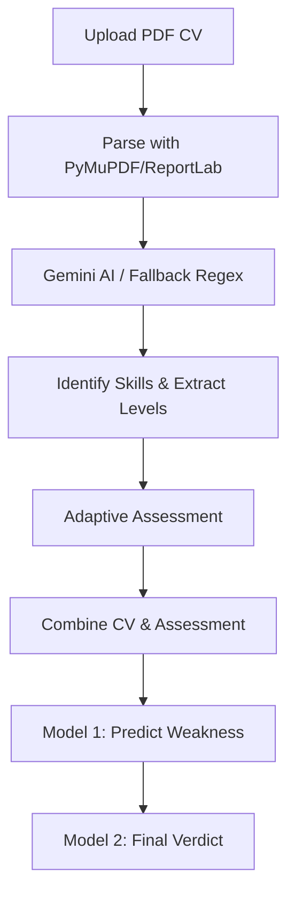

# Career Skill Assessment Platform

A full-stack platform that analyzes a candidate's CV against job requirements,
identifies skill gaps, and evaluates technical proficiency through adaptive
assessments.

## Features

- CV upload and text extraction
- Job requirement extraction
- CV-to-job skill matching
- Adaptive technical assessments
- Skill-level evaluation
- Skill-gap identification
- Readiness/recommendation system

## Tech Stack

Frontend:
- React
- Vite
- JavaScript

Backend:
- Python
- FastAPI
- PostgreSQL

AI / ML:
- Gemini API / Groq provider
- Scikit-learn

Tools:
- Docker
- Git

## Evaluation Results (latest run)

- **Skill Matching Precision (mocked LLM - keyword matcher on synthetic CVs, not LLM)**: 0.979
- **Skill Matching Recall (mocked LLM - keyword matcher on synthetic CVs, not LLM)**: 1.000
- **F1 Score (mocked LLM - keyword matcher on synthetic CVs, not LLM)**: 0.989
- **Parse Failures**: 0.0%
- **Rules Accuracy**: 100.0%
- **ML Accuracy**: 66.7%
- **Model 2 Override Rate**: 33.3%
- **Model 1 Override Rate**: 17.2%
- **Skill Level Override Rate**: 33.6%
- **API Errors**: 0.0%

*Note: Labels and rules both follow the same rubric, so rules accuracy is a consistency check, not an independent validation.*
*Note: The ML model was trained on the old formula and strongly disagrees with the new rubric, explaining the low ML accuracy vs 100% Rules accuracy.*

## Architecture Pipeline

## Run Steps

1. **Setup Environment**: Ensure Python 3.10+ is installed.
2. **Install Dependencies**: `pip install -r backend/requirements.txt`
3. **Run API Server**: `cd backend && uvicorn app.main:app --reload`
4. **Run Tests**: `pytest backend/tests/`
5. **Run Evaluation**: `python scripts/evaluate.py` (Set `GEMINI_MOCK=1` to bypass quota)
6. **Verify CV Match Pipeline**: `python scripts/test_mock_verify.py` (Verifies `/cv/analyze` end-to-end against a sample CV with both `GEMINI_MOCK=1` and live LLM providers such as Groq)

## Limitations

- The Gemini matching model is currently severely rate-limited on the free tier, necessitating `GEMINI_MOCK=1` for mass evaluation.
- Skill normalization relies on basic rules (e.g., JS = JavaScript, AWS = Amazon Web Services, ML = Machine Learning) which are not comprehensively mapped to an ontology.

## Responsible Use Note

This system uses AI to parse CVs and make decisions about candidate readiness. It should be used as an *assistive* tool for recruiters and hiring managers, not as an automated rejection engine. Candidates must always have the opportunity to contest AI-generated assessments or provide additional context. AI confidence scores are probabilistic and should be weighed alongside human judgment.

*Note: ML accuracy is measured on synthetic data from the same family as its training data and must not be read as real-world performance.*

## Status

🚧 Ongoing
