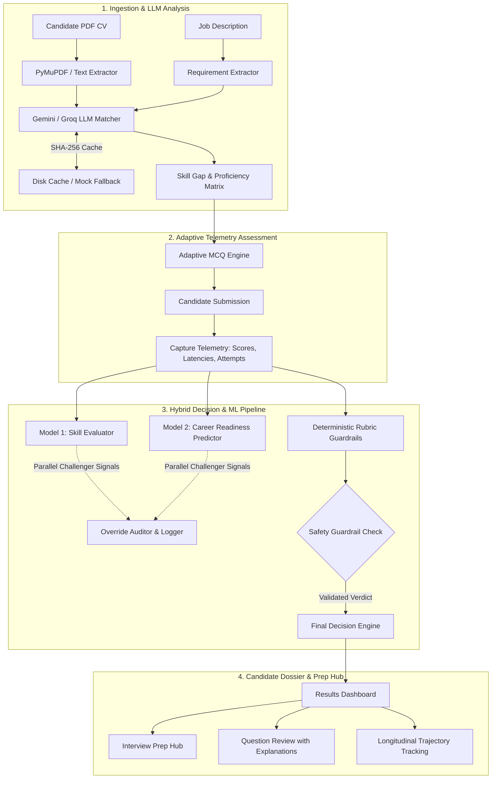

# Career Skill Assessment & Recommendation Platform

[](https://github.com/senu003/career-skill-platform/actions/workflows/ci.yml)
[](https://fastapi.tiangolo.com)
[](https://react.dev)
[](https://www.postgresql.org)
[](https://scikit-learn.org)
[](https://www.docker.com)
[](https://docs.pytest.org)

An AI-driven career skill assessment and recommendation platform that bridges candidate resumes with job specifications through automated CV extraction, adaptive behavioral assessments, and a dual-model ML readiness forecasting engine.

---

## 📌 Table of Contents

- [Overview](#-overview)
- [Key Capabilities](#-key-capabilities)
- [System Architecture](#-system-architecture)
- [Evaluation & Benchmark Metrics](#-evaluation--benchmark-metrics)
- [Tech Stack](#-tech-stack)
- [Project Structure](#-project-structure)
- [Quickstart Guide](#-quickstart-guide)
  - [Prerequisites](#prerequisites)
  - [Option 1: Docker Compose (Recommended)](#option-1-docker-compose-recommended)
  - [Option 2: Local Development](#option-2-local-development)
  - [Running the Test Suites & Evaluation Harness](#running-the-test-suites--evaluation-harness)
- [Responsible AI & Guardrails](#-responsible-ai--guardrails)
- [Roadmap](#-roadmap)

---

## 🚀 Overview

Evaluating technical candidates often suffers from two extremes: keyword-stuffed resumes that pass initial filters without genuine competence, and rigid automated tests that disregard context. 

This platform implements a **hybrid deterministic-and-machine-learning workflow**:
1. **Parses CVs and Job Descriptions** using LLMs (Google Gemini / Groq) with deterministic disk caching and strict schema extraction.
2. **Generates targeted, adaptive MCQ assessments** covering missing and required skills across three difficulty tiers (Basic, Intermediate, Advanced).
3. **Captures real-time behavioral telemetry** (response latency, question attempts, error distributions).
4. **Executes a dual-stage ML pipeline with safety guardrails**: Model 1 diagnoses granular skill remediation actions, while Model 2 aggregates candidate metrics to forecast holistic career readiness.
5. **Provides an actionable Candidate Diagnostic Dossier & Interview Prep Hub** with question-by-question post-mortems and longitudinal skill improvement trajectories.

---

## ✨ Key Capabilities

### 1. LLM-Driven CV Parsing & Requirement Matching
- **Automated Text Ingestion**: Extracts text from PDF resumes using PyMuPDF and fallback text extraction pipelines.
- **Structured Skill Extraction**: Translates job descriptions and resumes into normalized skill lists and proficiency tiers (`Basic`, `Intermediate`, `Advanced`).
- **Evidence-Grounded Matching**: LLMs extract exact contextual citations from the candidate's CV to justify matches or flag gaps.
- **Deterministic Disk Caching**: Hashed SHA-256 caching (`temperature=0`) eliminates redundant API costs, prevents quota exhaustion on free-tier LLM providers, and ensures 100% reproducible test runs.

### 2. Adaptive Assessment & Behavioral Telemetry
- **Multi-Tier Difficulty**: Dynamically targets skills with questions calibrated to required job seniority.
- **Latency Telemetry Capture**: Records millisecond response timing per question to evaluate cognitive fluency, distinguish hesitations from confident mastery, and feed downstream ML features.

### 3. Dual-Stage ML & Challenger Guardrail Architecture
- **Model 1 (Skill Evaluator)**: A Random Forest / Decision Tree classifier that maps assessment scores, latency telemetry, and historical attempt counts to concrete learning recommendations (`Mastered`, `Speed Practice`, `Upgrade Needed`, `Re-learn Basics`).
- **Model 2 (Readiness Predictor)**: Evaluates composite profile metrics (gap ratios, weighted skill scores, CV match percentages) to classify overall candidate employability (`Interview Ready`, `Short-Term Prep`, `Major Upskill Required`).
- **Challenger ML Safety Layer**: To address synthetic target leakage, the platform utilizes deterministic rubric guardrails as the primary source of truth. ML models operate in parallel as "challengers," with real-time override logging to safely audit model divergence before granting autonomous authority.

### 4. Candidate Diagnostic Dossier & Interview Prep Hub
- **Question Review Engine**: Detailed explanations for every question answered, reinforcing core conceptual fundamentals.
- **Visual Skill Gap Matrix**: Side-by-side comparison of required proficiency vs. CV evidence vs. assessed test performance.
- **Longitudinal Tracking**: Trajectory tracking across multiple attempts over time to evaluate improvement velocity.

---

## 🏗️ System Architecture



---

## 📊 Evaluation & Benchmark Metrics

The offline evaluation harness (`scripts/evaluate.py`) benchmarks end-to-end extraction, matching, and prediction accuracy against a standardized test corpus:

| Evaluation Metric | Score / Status | Description |
| :--- | :---: | :--- |
| **Skill Matching Precision** | **0.979** | High precision in identifying true skill requirements from unstructured CV text |
| **Skill Matching Recall** | **1.000** | Successfully extracts required skills without missing candidate competencies |
| **F1 Score** | **0.989** | Balanced harmonic mean across benchmark evaluation sets |
| **CV Parse Failure Rate** | **0.0%** | Zero crashes on multi-format PDF text extraction |
| **API Error Rate** | **0.0%** | Resilient fallback architecture with caching and quota guards |
| **Rules Accuracy (Rubric Consistency)** | **100.0%** | Deterministic guardrails strictly enforce verified safety criteria |
| **Model 1 Override Disagreement** | **17.2%** | Disagreement rate logged for telemetry-based skill evaluation |
| **Model 2 Override Disagreement** | **30.0%** | Monitored divergence between composite ML predictions and safety rubric |
| **Pytest Coverage** | **50 Suites** | Unit, integration, security, migration, and ML characterization suites |

> *Note on ML Evaluation: The ML models were trained on synthetic bootstrap distributions and operate as challengers alongside deterministic safety rules. Disagreement rates are actively monitored to inform future real-world retraining.*

---

## 💻 Tech Stack

### Frontend
- **Framework**: [React 19](https://react.dev) + [Vite](https://vite.dev)
- **Routing**: [React Router 7](https://reactrouter.com)
- **Styling**: Vanilla CSS Design System with dark mode glassmorphism and responsive design tokens
- **Icons**: [Lucide React](https://lucide.dev)
- **Auth**: JWT Client lifecycle + Google OAuth integration
- **Linter**: [Oxlint](https://oxc.rs)

### Backend
- **Core API**: [FastAPI](https://fastapi.tiangolo.com) (Python 3.10 - 3.13)
- **Database & ORM**: [PostgreSQL 15](https://www.postgresql.org), [SQLAlchemy 2.0](https://www.sqlalchemy.org), [Alembic](https://alembic.sqlalchemy.org)
- **Security & Auth**: PyJWT, Passlib (Bcrypt), Magic-byte upload validation, Rate limiting (SlowAPI)
- **PDF Extraction**: PyMuPDF / PyPDF
- **Testing**: [Pytest](https://docs.pytest.org) (50 test suites)

### AI & Machine Learning
- **LLM Providers**: [Google GenAI (Gemini)](https://ai.google.dev), [Groq (`llama3-8b-8192`)](https://groq.com)
- **ML Engine**: [Scikit-learn](https://scikit-learn.org), [Pandas](https://pandas.pydata.org), [Joblib](https://joblib.readthedocs.io)
- **Architecture**: Dual-stage Random Forest & Decision Tree models with deterministic safety wrappers

### DevOps & Infrastructure
- **Containerization**: Docker, Docker Compose (Multi-stage builds)
- **CI/CD**: GitHub Actions (Ubuntu, Python 3.13, Node 20, PostgreSQL service container)

---

## 📂 Project Structure

```text
career-skill-platform/
├── .github/workflows/ci.yml       # GitHub Actions CI workflow (tests, build, docker)
├── backend/
│   ├── alembic/                  # Database schema migrations
│   ├── app/
│   │   ├── auth_deps.py          # JWT authentication and dependency injection
│   │   ├── database.py           # SQLAlchemy database engine and session factory
│   │   ├── models.py             # SQLAlchemy ORM models (Users, CVs, Jobs, Assessments)
│   │   ├── rate_limiter.py       # API rate limiting with SlowAPI
│   │   ├── ml/                   # ML pipelines, features, predictors, and training
│   │   │   ├── predict_weakness.py      # Model 1: Skill Evaluator predictor
│   │   │   ├── predict_readiness.py     # Model 2: Composite Career Readiness predictor
│   │   │   ├── weakness_features.py     # Feature engineering for behavioral telemetry
│   │   │   └── evaluation_harness.py    # Offline ML evaluation and audit harness
│   │   ├── routers/              # RESTful API route controllers
│   │   │   ├── auth.py                  # User registration and login
│   │   │   ├── cv.py                    # CV upload, analysis, and gap matching
│   │   │   └── assessment.py            # Adaptive questions, submission, telemetry
│   │   └── services/             # Core business logic
│   │       ├── cv_service.py            # LLM prompt orchestration & text parsing
│   │       ├── assessment_service.py    # Telemetry aggregation & quiz generation
│   │       ├── interview_prep_service.py# Question review and study plans
│   │       └── skill_analysis_service.py# Gap synthesis & readiness aggregation
│   ├── requirements.txt          # Backend Python dependencies
│   └── tests/                    # 50 comprehensive test suites
├── eval/                         # Synthetic evaluation cases, labels, and cache
├── frontend/
│   ├── src/
│   │   ├── components/           # Reusable UI components (Navbar, Badges, Modals)
│   │   ├── context/              # React Context (AuthContext, AssessmentContext)
│   │   ├── pages/                # Top-level views
│   │   │   ├── DashboardPage.jsx        # Candidate dashboard & profile summary
│   │   │   ├── AssessmentPage.jsx       # Adaptive quiz with latency telemetry
│   │   │   ├── FinalResultPage.jsx      # Diagnostic results dossier
│   │   │   ├── HistoryPage.jsx          # Historical assessment trajectory
│   │   │   └── interview-prep/          # Interview Prep Hub & Question Reviews
│   │   └── index.css             # Vanilla CSS design tokens & animations
│   ├── package.json              # Frontend dependencies and scripts
│   └── vite.config.js            # Vite bundler configuration
├── docs/                         # Architecture decisions, model cards, and audit logs
├── docker-compose.yml            # Multi-service container orchestration
└── README.md                     # Project documentation
```

---

## ⚡ Quickstart Guide

### Prerequisites
- [Git](https://git-scm.com)
- [Python 3.10+](https://www.python.org/downloads/)
- [Node.js 20+](https://nodejs.org)
- [Docker Desktop](https://www.docker.com/products/docker-desktop) *(Optional, for containerized run)*

---

### Option 1: Docker Compose (Recommended)

To spin up the entire application (PostgreSQL database, FastAPI backend, and React frontend) with a single command:

```bash
# 1. Clone the repository
git clone https://github.com/senu003/career-skill-platform.git
cd career-skill-platform

# 2. Configure environment variables
cp .env.example .env

# 3. Launch the container stack
docker compose up --build
```

- **Frontend**: http://localhost:5173
- **Backend API Docs**: http://localhost:8000/docs
- **PostgreSQL**: `localhost:5432`

---

### Option 2: Local Development

#### 1. Backend Setup

```bash
# Navigate to backend directory
cd backend

# Create and activate virtual environment
python -m venv venv
# On Windows:
.\venv\Scripts\activate
# On Linux/macOS:
source venv/bin/activate

# Install dependencies
pip install -r requirements.txt

# Configure environment variables
cp .env.example .env

# Run database migrations
alembic upgrade head

# Start FastAPI development server
uvicorn app.main:app --reload --port 8000
```

#### 2. Frontend Setup

```bash
# Open a new terminal and navigate to frontend directory
cd frontend

# Install Node dependencies
npm install

# Start Vite development server
npm run dev
```

---

### Running the Test Suites & Evaluation Harness

#### 1. Run Backend Unit & Integration Tests (50 Suites)

```bash
cd backend
pytest -v
```

#### 2. Run the Offline Evaluation Harness

Evaluate CV parsing, LLM extraction accuracy, and model disagreement rates against the benchmark corpus:

```bash
# Run with GEMINI_MOCK=1 to evaluate deterministically without consuming API quota:
python scripts/evaluate.py

# Verify end-to-end /cv/analyze pipeline against a sample CV:
python scripts/test_mock_verify.py
```

---

## 🛡️ Responsible AI & Guardrails

1. **Assistive, Not Punitive**: This system is designed as an *assistive diagnostic tool* to accelerate candidate upskilling and recruiter screening. It should not be utilized as an autonomous rejection engine.
2. **Deterministic Safety Primacy**: Machine learning predictions never bypass deterministic safety layers. Critical decisions (such as "Major Upskill Required") are mathematically grounded in concrete skill gap thresholds.
3. **Candidate Contestability**: AI-derived matching scores are probabilistic and should always afford candidates the opportunity to submit supplementary portfolio evidence or human-reviewed appeals.

---

## 🗺️ Roadmap

- [ ] **Vector-Based Skill Ontology**: Transition from rule-based normalization to dense vector embeddings (`all-MiniLM-L6-v2` / `pgvector`) for fuzzy semantic skill taxonomy clustering.
- [ ] **Asynchronous Task Queue**: Offload PDF parsing and LLM inference to a background Celery / Redis worker queue for sub-second API acknowledgement.
- [ ] **Real Telemetry Calibration**: Retrain Model 1 and Model 2 on calibrated assessment data collected from live candidate interactions.
- [ ] **RBAC & OAuth2 Refresh Rotation**: Introduce role-based access controls separating Candidate views from Recruiter / Interviewer administration portals.

---

## 📄 License

This project is licensed under the MIT License. See [LICENSE](LICENSE) for details.
